# CHAPTER FOUR

**Regression with penalization: LASSO and Elastic Net**

- Module Code: **EC4308**
- Module title: **Machine Learning and Economic Forecasting**
- Instructor: **Vu Thanh Hai**
- Reference: **ISLR Ch. 6.2.2–6.2.3; 6.4.3–6.4.4**
- *Acknowledgement: I adapt Dr. Denis Tkachenko’s notes with some minor modifications. Thanks to Denis!*

# Lecture outline

1. **The LASSO**: introduction and motivation
2. **The LASSO problem and details**
3. **Interpreting LASSO shrinkage** vs. Ridge and best subset
4. Combining LASSO and Ridge: the **Elastic Net**
5. **Choice of tuning parameter** ($\lambda$)
6. Notes on statistical properties, sparsity, and regressor screening
7. **Application**: Credit data (using `glmnet` and `hdm`)
8. **Concluding remarks**

# Motivation: drawbacks of Ridge

So far we saw two approaches to regularizing linear regression:

1. **Subset selection**:
   - Resulted in very interpretable models, and estimated those models without much bias.
   - **Two issues**: 1) potentially high variance due to the discrete nature of the problem; 2) computationally costly for $p > 30$ (combinatorial explosion, $2^p$ models).
2. **Ridge regression**:
   - Results in low-variance predictions, but coefficient estimates are biased due to shrinkage toward zero.
   - **Key drawback**: keeps all $p$ predictors in the model ($\hat{\beta}_j^R \ne 0$) — *loss of interpretability*.

> **Goal**: Need to find a way to keep the good features of both methods while mitigating the drawbacks: achieve **variance reduction** like Ridge and **variable selection** like subset selection.

# Motivation: Idea of LASSO

**Tibshirani (1996)** proposed an alternative shrinkage procedure with the idea to do just that!

- **Least Absolute Shrinkage and Selection Operator (LASSO)**.
- **The main idea is to shrink AND select**:
  - The coefficients are shrunk away from their OLS counterparts;
  - Crucially, some are shrunk **EXACTLY to 0**.
- **Computational complexity** is kept under control via convex optimization.
- **VERY popular in economics**, particularly due to the model selection aspect and post-selection inference theory.

# LASSO method

LASSO is similar to Ridge at first glance, with a small but subtle difference in the penalty:

$$\min_{\beta_0, \beta} \left\{ \sum_{i=1}^n \left( y_i - \beta_0 - \sum_{j=1}^p \beta_j x_{ij} \right)^2 + \lambda \sum_{j=1}^p |\beta_j| \right\} = \text{RSS} + \lambda \|\beta\|_1$$

- $\lambda \ge 0$ is the **tuning parameter** (penalty multiplier), and $\sum_{j=1}^p |\beta_j| = \|\beta\|_1$ is the **$\ell_1$-norm penalty**.
- Equivalent constrained optimization formulation ("budget" problem):
  $$\min_{\beta_0, \beta} \sum_{i=1}^n \left( y_i - \beta_0 - \sum_{j=1}^p \beta_j x_{ij} \right)^2 \quad \text{subject to} \quad \sum_{j=1}^p |\beta_j| \le s$$
- There is a 1-to-1 correspondence between $\lambda$ and budget $s$.

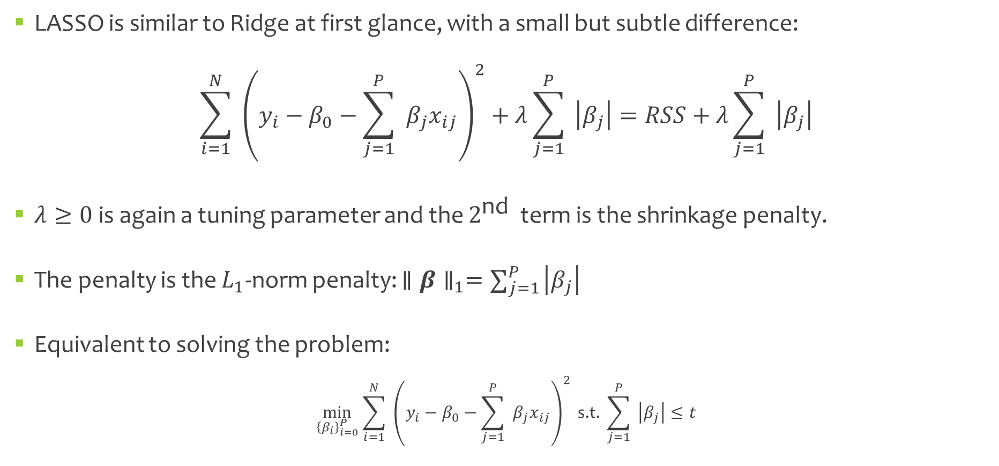{fig-align="center" width="80%"}

# Some details

- **Intercept is not penalized**: The summation over $\beta$ goes from $1$ to $p$.
  - For this reason, variables and outcomes are usually **de-meaned** before estimation: $\bar{y} = 0, \bar{x}_j = 0$, so $\hat{\beta}_0 = 0$.
- **Scale dependence**: LASSO, like Ridge, is **not scale invariant**.
  - All regressors must be in the same units: regressors are typically **standardized** to unit variance ($\frac{1}{n} \sum_i x_{ij}^2 = 1$).
- **Lack of invariance to linear transformations**:
  - LASSO on $(X_1, X_2)$ is not the same as on $(X_1 + X_2, X_1 - X_2)$, despite identical OLS solutions.
  - Domain knowledge and contextual justification are critical.
- **No closed-form solution**:
  - Unlike Ridge, the LASSO estimator has no closed-form matrix formula because the absolute value function is non-differentiable at zero.
  - However, the problem is **convex**, and fast algorithms (coordinate descent, LARS) make computational cost comparable to Ridge.

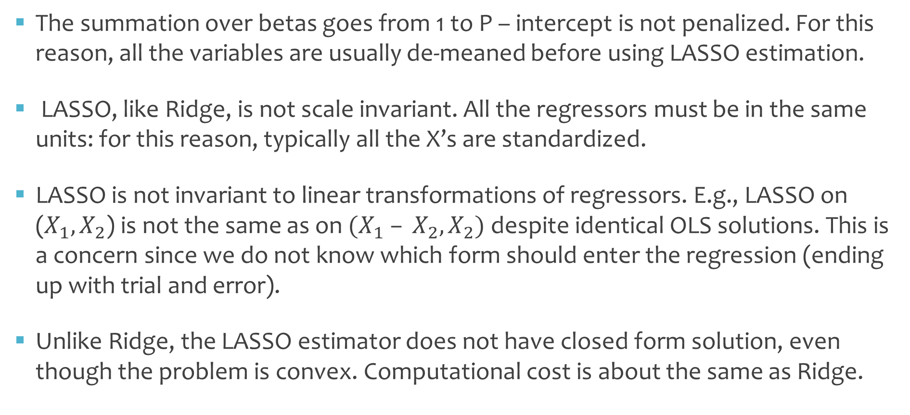{fig-align="center" width="75%"}

# OLS on a "budget":

Comparing the constrained formulations reveals the geometry of each penalty:

- **The LASSO problem**:
  $$\min_{\beta} \text{RSS} \quad \text{subject to} \quad \sum_{j=1}^p |\beta_j| \le s \quad (\ell_1 \text{ ball})$$
- **The Ridge problem**:
  $$\min_{\beta} \text{RSS} \quad \text{subject to} \quad \sum_{j=1}^p \beta_j^2 \le s \quad (\ell_2 \text{ disk})$$
- **The Best Subset selection problem**:
  $$\min_{\beta} \text{RSS} \quad \text{subject to} \quad \sum_{j=1}^p I(\beta_j \ne 0) \le s \quad (\ell_0 \text{ pseudo-norm})$$

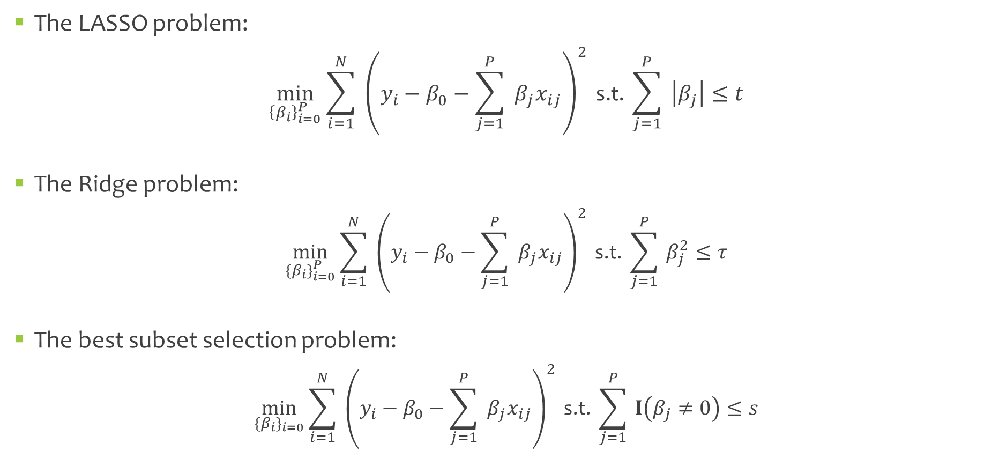{fig-align="center" width="85%"}

# Shrinkage interpretation (under special case)

To see the exact mechanism of shrinkage, consider the **orthonormal regressors case**:

$$X^T X = I_p \quad \text{and} \quad \sum_{i=1}^n y_i = 0$$

- The OLS estimator simplifies to:
  $$\hat{\beta}^{OLS} = (X^T X)^{-1} X^T Y = X^T Y$$
- Element-wise for each predictor $j = 1, \dots, p$:
  $$\hat{\beta}_j^{OLS} = X_j^T Y$$

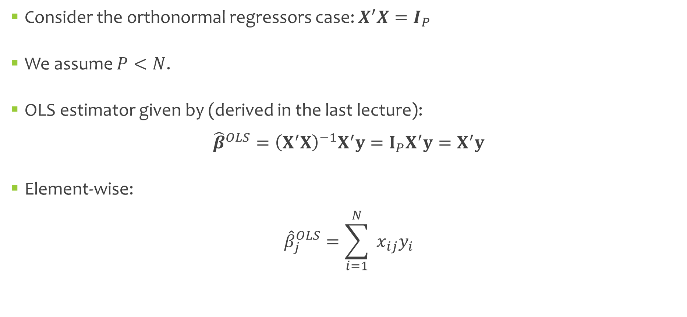{fig-align="center" width="70%"}

# Shrinkage interpretation (under special case)

Under the same orthonormal design, **Ridge regression** minimizes:

$$\sum_{i=1}^n \left( y_i - \sum_{j=1}^p \beta_j x_{ij} \right)^2 + \lambda \sum_{j=1}^p \beta_j^2$$

- The solution is:
  $$\hat{\beta}^R = (X^T X + \lambda I)^{-1} X^T Y = (I + \lambda I)^{-1} X^T Y = \frac{1}{1 + \lambda} X^T Y$$
- Element-wise:
  $$\hat{\beta}_j^R = \frac{\hat{\beta}_j^{OLS}}{1 + \lambda}$$
- Ridge applies **proportional shrinkage**: every coefficient is scaled down by the factor $\frac{1}{1+\lambda}$, regardless of its magnitude.

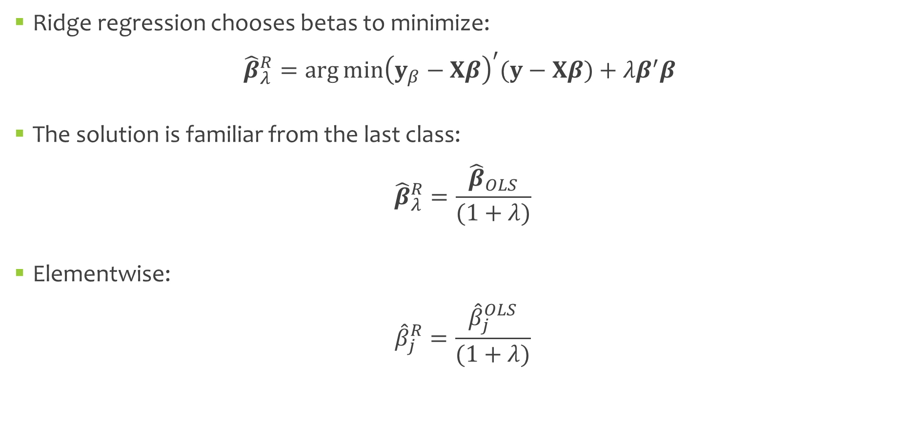{fig-align="center" width="75%"}

# Shrinkage interpretation (under special case)

Under the same orthonormal design, **LASSO** minimizes:

$$\sum_{i=1}^n \left( y_i - \sum_{j=1}^p \beta_j x_{ij} \right)^2 + \lambda \sum_{j=1}^p |\beta_j|$$

- The element-wise solution is given by the **soft-thresholding operator**:
  $$\hat{\beta}_j^L = \begin{cases} \hat{\beta}_j^{OLS} - \frac{\lambda}{2} & \text{if } \hat{\beta}_j^{OLS} > \frac{\lambda}{2} \\ \hat{\beta}_j^{OLS} + \frac{\lambda}{2} & \text{if } \hat{\beta}_j^{OLS} < -\frac{\lambda}{2} \\ 0 & \text{if } |\hat{\beta}_j^{OLS}| \le \frac{\lambda}{2} \end{cases} = \text{sign}\left(\hat{\beta}_j^{OLS}\right) \left( |\hat{\beta}_j^{OLS}| - \frac{\lambda}{2} \right)_+$$

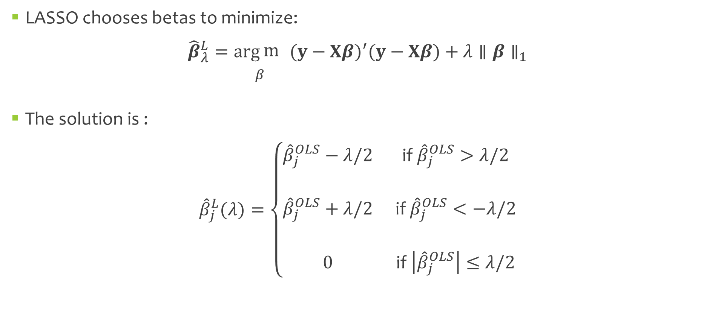{fig-align="center" width="80%"}

# Shrinkage interpretation (under special case)

Now we can see how the nature of shrinkage differs fundamentally:

- **Ridge regression**: shrinks OLS coefficients by the **same proportion** $\frac{1}{1+\lambda}$.
- **LASSO**: shrinks coefficients toward zero by a **constant amount** $\lambda/2$. If the coefficient is smaller than $\lambda/2$ in absolute value, it is set **exactly to zero** — **soft thresholding**.
- **Best subset selection**: leaves large coefficients unchanged and zeroes out small ones — **hard thresholding**:
  $$\hat{\beta}_j^{BS} = \hat{\beta}_j^{OLS} \cdot I\left( |\hat{\beta}_j^{OLS}| > \sqrt{\lambda} \right)$$
- **Non-orthonormal case**: When $X$ is not orthogonal, the algebra is coupled across predictors, but the geometric intuition remains: shrinkage occurs in roughly the same manner.

# Shrinkage and selection

Why does LASSO set coefficients to zero while Ridge does not?

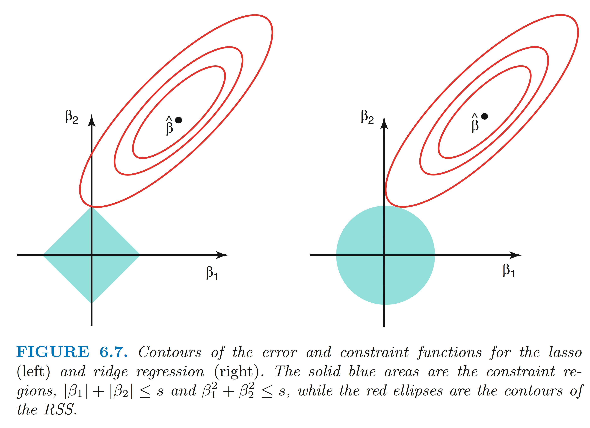{fig-align="center" width="80%"}

::: {.footer-note}
Source: James et al. (2014), ISLR, Springer
:::

# Shrinkage and selection

Comparing the thresholding functions for the orthogonal case:

$$\hat{\beta} \text{ as a function of } \hat{\beta}^{OLS}$$

::: {layout-ncol=2}
{width="90%"}

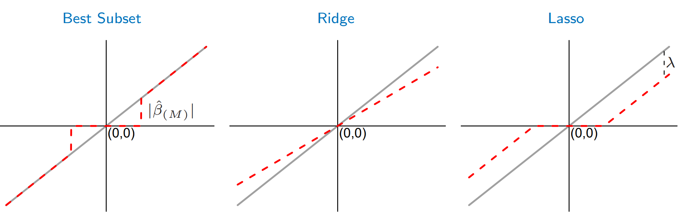{width="90%"}
:::

::: {.footer-note}
Source: Figure 3.11 in Elements of Statistical Learning (Hastie et al., 2009)
:::

# Shrinkage and selection

- The RSS contours are ellipses centered at the unconstrained OLS estimate $\hat{\beta}^{OLS}$.
- The constraint region for LASSO is a **diamond** (rhombus, with corners on the axes).
- The constraint region for Ridge is a **circle/disk** (smooth everywhere).
- Because the diamond has **sharp corners** lying on the coordinate axes, the elliptical contours frequently make first contact at a corner — where one or more coordinates equal zero!

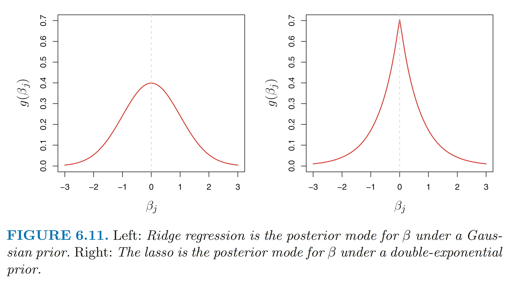{fig-align="center" width="80%"}

::: {.footer-note}
Source: James et al. (2014), ISLR, Springer
:::

# Bias/variance tradeoff

- As $\lambda$ increases (budget $s$ decreases), shrinkage increases: **bias increases** while **variance decreases**.
- The optimal $\lambda$ minimizes test MSE, balancing bias squared and variance.

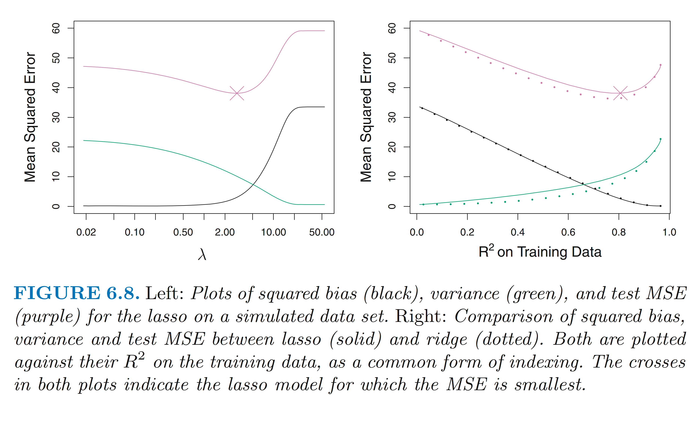{fig-align="center" width="80%"}

::: {.footer-note}
Source: James et al. (2014), ISLR, Springer
:::

# LASSO vs. Ridge

Though often effective in practice, LASSO has some notable shortcomings:

1. **Collinear predictors**: If there is a group of highly correlated variables, LASSO tends to select **one of them arbitrarily** and zero out the rest, even when all have substantive meaning.
2. **Saturating when $p > n$**: In high-dimensional settings where $p > n$, LASSO can select at most $n$ variables before it saturates.
3. **Empirical performance under correlation**: When variables in $X$ are moderately or highly correlated, Ridge often outperforms LASSO in out-of-sample prediction MSE.

> **Key question**: Can we find a compromise between Ridge and LASSO that yields both grouping and sparsity?

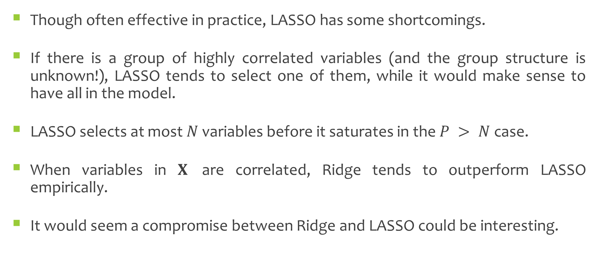{fig-align="center" width="70%"}

# LASSO – Ridge compromise ?

One theoretical way to achieve such a compromise is to consider the **$L_q$ nesting penalty**:

$$\min_{\beta} \sum_{i=1}^n \left( y_i - \sum_{j=1}^p \beta_j x_{ij} \right)^2 \quad \text{subject to} \quad \sum_{j=1}^p |\beta_j|^q \le s$$

::: {layout-ncol=2}
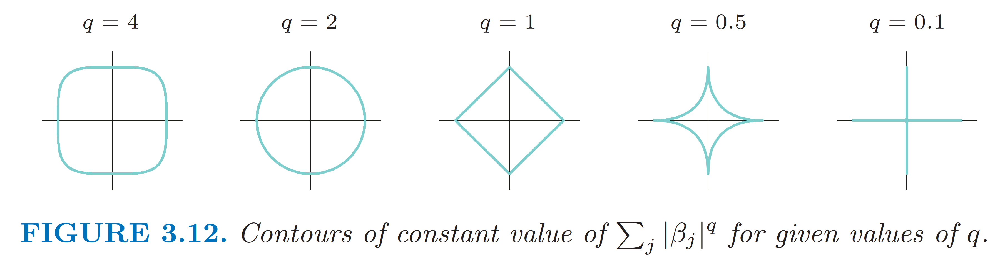{width="85%"}

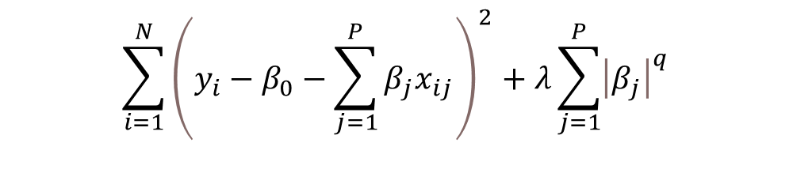{width="85%"}
:::

::: {.footer-note}
Source: Hastie et al. (2009): Elements of Statistical Learning, Springer
:::

# LASSO – Ridge compromise ?

Nesting penalty with $q \in [1, 2]$:

$$\sum_{j=1}^p |\beta_j|^q \le s$$

- The values of $q$ between $1$ and $2$ suggest a compromise between LASSO ($q=1$) and Ridge ($q=2$).
- **However, for $q > 1$**, the function $|\beta_j|^q$ is strictly differentiable at zero: the constraint boundary has **rounded corners**, so the variable-selection property is lost!
- For $q < 1$, the constraint region is non-convex, making global optimization computationally intractable.
- In practice, this method does not work well. We need a better alternative.

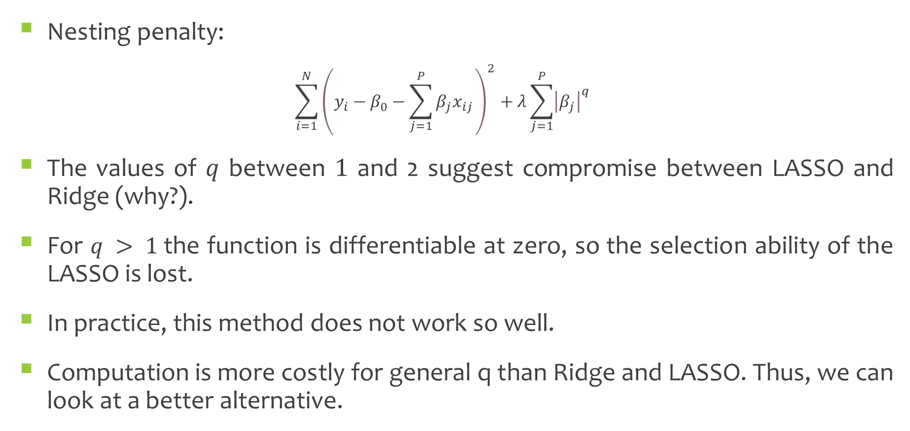{fig-align="center" width="70%"}

# The Elastic Net

Motivated by these shortcomings, **Zou and Hastie (2005)** proposed the **Elastic Net**:

$$\min_{\beta_0, \beta} \left\{ \sum_{i=1}^n \left( y_i - \beta_0 - \sum_{j=1}^p \beta_j x_{ij} \right)^2 + \lambda_1 \sum_{j=1}^p |\beta_j| + \lambda_2 \sum_{j=1}^p \beta_j^2 \right\}$$

Equivalent parametrization (used in `glmnet`):

$$\min_{\beta_0, \beta} \left\{ \text{RSS} + \lambda \sum_{j=1}^p \left( \alpha |\beta_j| + \frac{1-\alpha}{2} \beta_j^2 \right) \right\}$$

- $\alpha = 1 \implies \text{LASSO}$
- $\alpha = 0 \implies \text{Ridge}$
- $0 < \alpha < 1 \implies \text{Elastic Net}$

::: {layout-ncol=2}
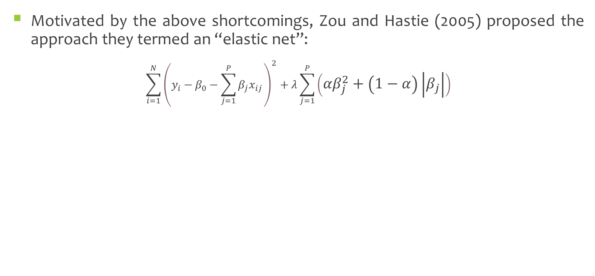{width="85%"}

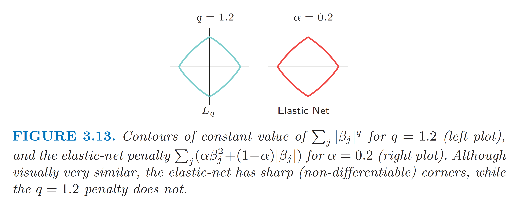{width="85%"}
:::

# The Elastic Net

- The Elastic Net **selects variables like LASSO** and **shrinks coefficients of correlated predictors together like Ridge** (**grouping effect**).
- It retains **sharp corners** at the axes (allowing exact zeros) while having **strictly convex contours** between axes:
  - Makes it harder to push $\beta$ to zero when predictors are correlated, grouping them together.
- Overcomes the $p > n$ limitation: can select more than $n$ variables.
- Selection of tuning parameters $(\lambda, \alpha)$ can be done jointly by $K$-fold cross-validation.

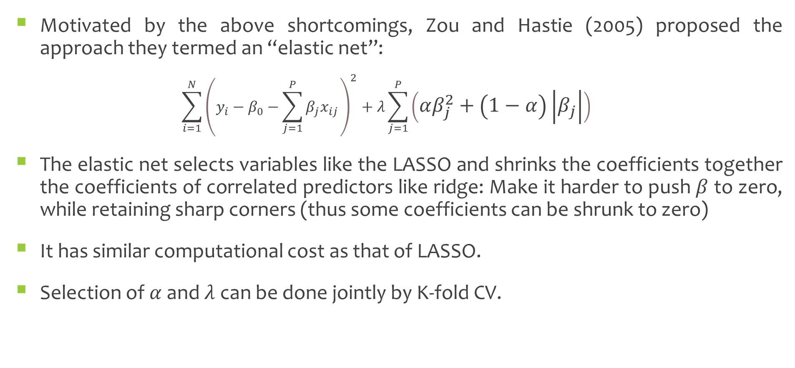{fig-align="center" width="75%"}

# The Elastic Net Illustration

The Elastic Net constraint contour combines the singularities of $\ell_1$ with the curvature of $\ell_2$:

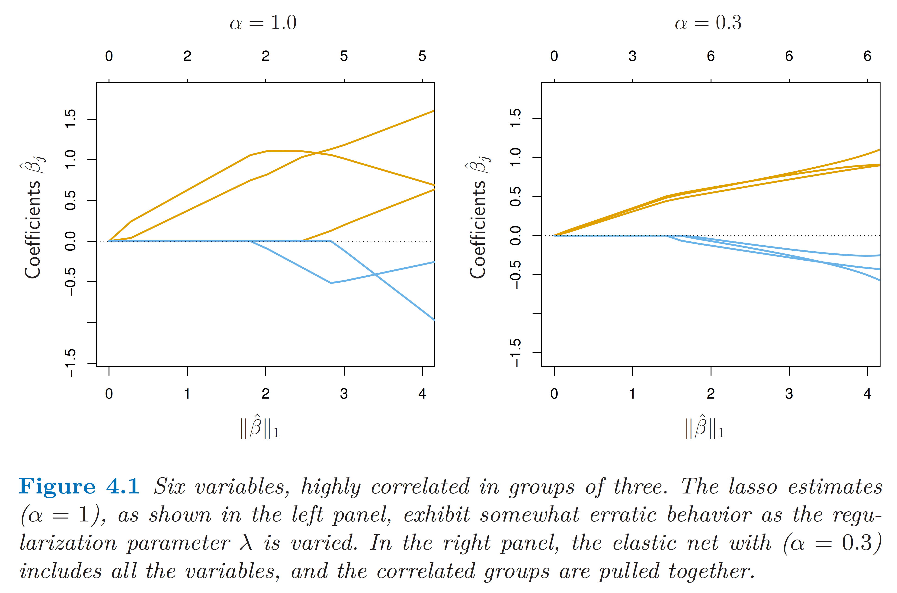{fig-align="center" width="70%"}

::: {.footer-note}
Source: Hastie et al. (2015): *Statistical Learning with Sparsity: The Lasso and Generalizations*, CRC Press
:::

# Choice of $\lambda$ (LASSO): CV

Choosing $\lambda$ is the critical decision that determines model performance:

- Most popular approach: **$K$-fold Cross-Validation** (typically 5-fold or 10-fold) over a grid of $\lambda$ values.
- **Note**: We cannot use the LOOCV hat-matrix shortcut formula since LASSO has no closed-form linear solution.
- Results can be sensitive across random fold splits:
  - Prudent to use 10 folds, or repeat CV across multiple random seeds and take the median / modal $\lambda$.
- **Theory**: Chernozhukov, Chetverikov, and Liao (2020) establish that CV estimation error converges to zero under regularity conditions in the Normal model.

::: {layout-ncol=2}
{width="85%"}

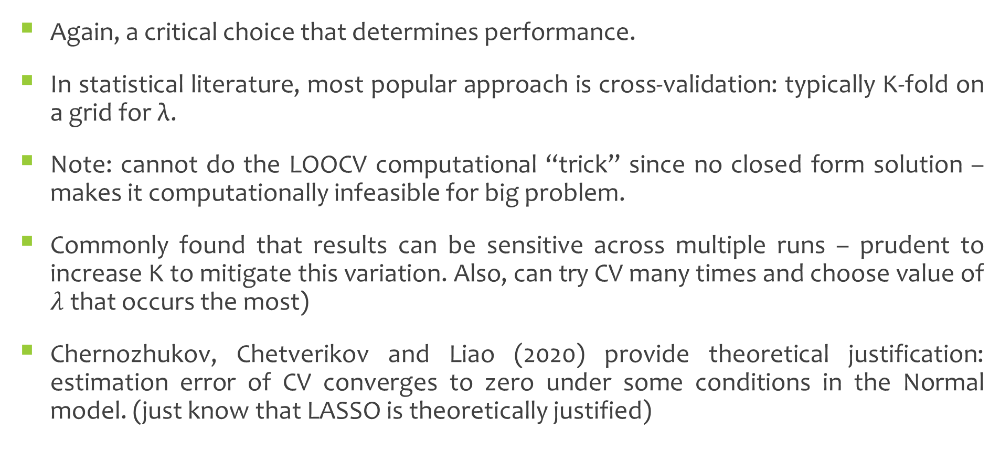{width="85%"}
:::

# Choice of $\lambda$: The “1 SE rule” for CV

When performing CV in penalized regression, practitioners frequently use the **one standard error rule**:

1. Calculate the standard error of the estimated CV MSE across folds for each $\lambda$:
   $$\text{SE}(\text{CV}(\lambda)) = \frac{\text{SD}(\text{MSE}_k(\lambda))}{\sqrt{K}}$$
2. Identify $\lambda_{\min}$ which achieves the minimum cross-validated MSE.
3. Select **$\lambda_{1\text{se}}$**, the largest $\lambda$ (most regularized, smallest model) whose CV error is within $1\text{SE}$ of $\lambda_{\min}$:
   $$\lambda_{1\text{se}} = \max \{ \lambda : \text{CV}(\lambda) \le \text{CV}(\lambda_{\min}) + \text{SE}(\text{CV}(\lambda_{\min})) \}$$

> **Important Conceptual Note**: The standard error of the estimated MSE is **not** the standard deviation of $\lambda$. There is no sampling distribution of $\lambda$ because $\lambda$ is a deterministic tuning choice, not a random variable.
>
> **Rationale**: Models within $1\text{SE}$ are essentially indistinguishable in predictive performance; parsimony dictates choosing the simpler, sparser model.

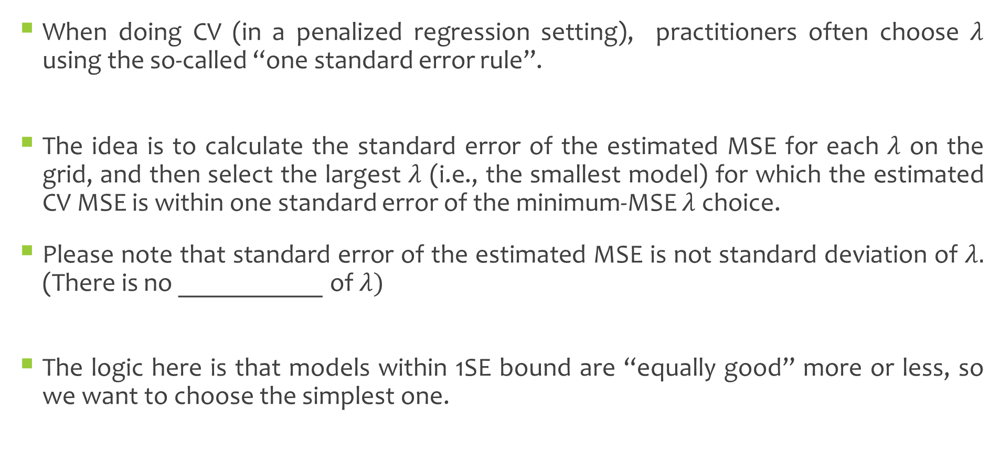{fig-align="center" width="70%"}

# Choice of $\lambda$: plug-in rules

Under structural assumptions, theoretically optimal plug-in rules for $\lambda$ can be derived analytically (**Belloni, Chernozhukov, and Hansen 2010, 2012**):

- Baseline case (homoskedastic errors, uncorrelated $X$'s):
  $$\lambda = 2 c \sigma \sqrt{2n \log(2p / \gamma)}$$
  where $c > 1$ (typically $c = 1.1$), $\sigma$ is error standard deviation, and $1 - \gamma$ is a confidence level.
- Extensions exist for correlated regressors and heteroskedastic / clustered errors.
- Implemented in R package `hdm` via the function `rlasso()`.

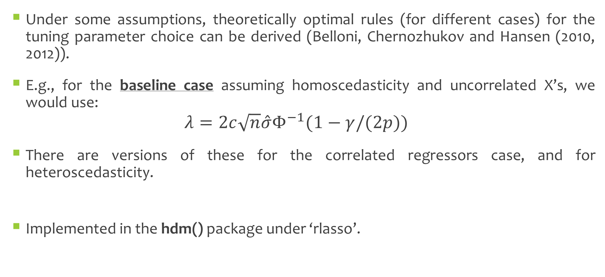{fig-align="center" width="75%"}

# Statistical properties

Asymptotic properties are derived allowing for high dimensions ($p \gg n$):

- **Sparsity assumption**: The true model has $s$ non-zero coefficients, where $s \ll n$.
- **Model selection consistency**: Under sparsity and the *irrepresentable condition*, LASSO selects the true active set asymptotically.
- **Shrinkage bias**: Estimated coefficients are systematically biased toward zero.
- Methods to mitigate shrinkage bias:
  1. **Post-LASSO least squares** (Belloni & Chernozhukov, 2013)
  2. **Adaptive LASSO** (Zou, 2006 — weights inversely proportional to initial estimates)
  3. **SCAD / MCP** (Fan & Li, 2001; Zhang, 2010 — non-convex folded concave penalties)

# Post-LASSO estimation

**Belloni and Chernozhukov (2013)** propose an intuitive and computationally simple fix:

> Undo the shrinkage bias by applying unpenalized OLS using **only the variables selected by LASSO**.

- Let $\hat{S} = \{ j : \hat{\beta}_j^L \ne 0 \}$ be the active set.
- Estimate by OLS:
  $$\hat{\beta}_{\hat{S}}^{\text{post-LASSO}} = (X_{\hat{S}}^T X_{\hat{S}})^{-1} X_{\hat{S}}^T Y$$
- Post-LASSO removes attenuation bias on selected variables while preserving sparsity.
- Theoretical convergence rates are established when combined with plug-in penalties (`rlasso(..., post = TRUE)`).

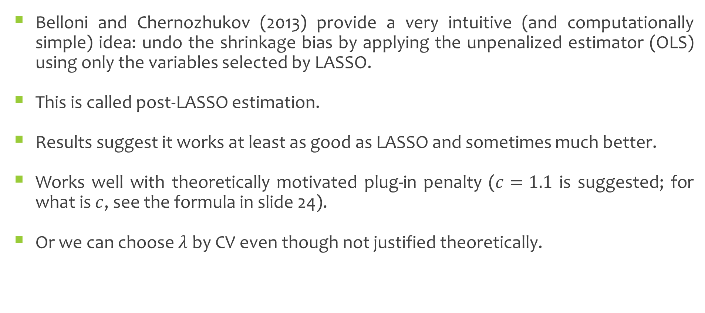{fig-align="center" width="70%"}

# Note on Sparsity

- **Sparsity is a mathematical convenience**:
  - Key assumption for justifying high-dimensional asymptotic theory ($p \gg n$).
  - However, in real-world economic applications, exact sparsity may not hold.
- **Dense vs. Sparse models**:
  - In practice, many predictors might have small, non-zero causal or predictive effects rather than strictly zero effects.
  - When true signals are dense and small, Ridge or model-averaging methods often outperform LASSO.
- Always question whether imposing sparsity is substantively warranted for your economic problem.

# Note on screening of regressors

When $p$ is extremely large, pre-screening before LASSO helps computational tractability:

- **Sure Independence Screening (SIS)** (**Fan and Lv 2008**):
  - Rank all $p$ predictors by their marginal correlation with $Y$:
    $$\omega_j = |X_j^T Y|$$
  - Retain only the top $d$ most correlated variables, where:
    $$d = \left\lfloor \frac{n}{\log n} \right\rfloor \quad \text{or} \quad d = n - 1$$
- Under regularity conditions, SIS enjoys the **sure screening property**: with probability approaching 1, the retained subset contains the true active variables.

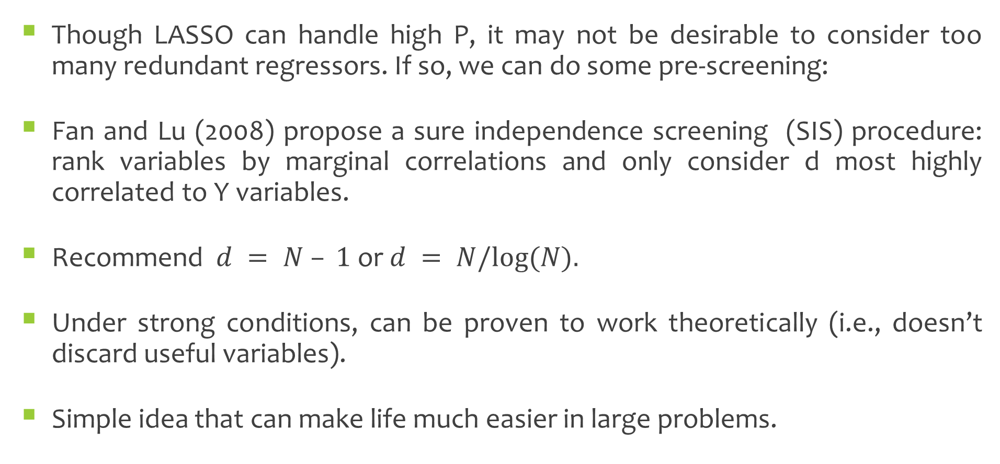{fig-align="center" width="70%"}

# Note on regressor transformation

- Much theoretical insight for LASSO is obtained under orthogonal or near-orthogonal regressors.
- Whenever possible, consider **context-driven transformations** that reduce collinearity:
  - E.g., interest rates across maturities are collinear in levels; term spreads ($R_{10\text{yr}} - R_{3\text{mo}}$) are much less correlated.
  - Log-differences, ratios, or orthogonal components based on domain knowledge.
- Helps LASSO avoid arbitrary selection among correlated features.

# Application: Credit Data

Data from ISLR package on credit card balances ($n=400$ observations, 10 predictors):

| Predictor | Description |
|:---|:---|
| **Income** | Income in $\$1,000$s |
| **Limit** | Credit limit ($\$$) |
| **Rating** | Credit rating |
| **Cards** | Number of credit cards |
| **Age** | Age in years |
| **Education** | Years of education |
| **Gender** | Factor: Male / Female |
| **Student** | Factor: No / Yes |
| **Married** | Factor: No / Yes |
| **Ethnicity** | Factor: African American, Asian, Caucasian |
| **Balance** | Response: Average credit card balance ($\$$) |

::: {layout-ncol=2}
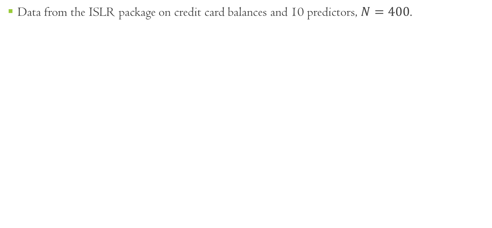{width="85%"}

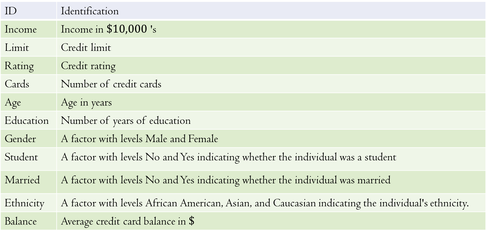{width="85%"}
:::

# Application: R package `glmnet()`

Fit LASSO and Elastic Net using `glmnet`:

```r
library(glmnet)

## Basic syntax
fit = glmnet(x, y, alpha = 1, lambda = grid)
```

- `alpha = 1` yields **LASSO**;
- `alpha = 0` yields **Ridge**;
- `0 < alpha < 1` yields **Elastic Net**.
- If `lambda` is not specified, `glmnet` computes an internal sequence from $\lambda_{\max}$ down.
- Cross-validation with `cv.glmnet(x, y, alpha = 1)` provides:
  - `lambda.min`: $\lambda$ with minimum cross-validated error;
  - `lambda.1se`: largest $\lambda$ within 1 standard error of minimum.

# Application: R package `hdm()`

Fit theoretically guided LASSO using the `hdm` (High-Dimensional Metrics) package:

```r
library(hdm)

## Fit plug-in LASSO with post-estimation
fit = rlasso(Balance ~ ., data = Credit_train, post = TRUE)
```

- `post = TRUE` automatically performs **post-LASSO OLS estimation** on selected regressors.
- `post = FALSE` delivers penalized plug-in estimates.
- Default penalty adjusts for heteroskedasticity and non-Gaussian errors.

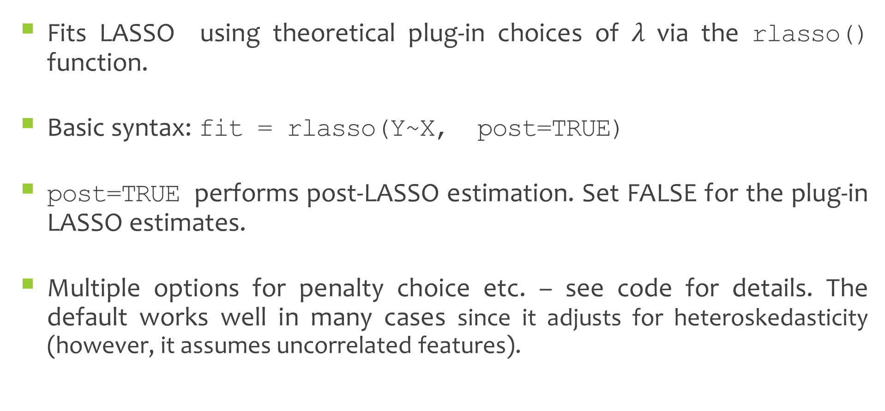{fig-align="center" width="75%"}

# Application: effect of $\lambda$ on coefficients

Coefficient paths showing variable selection as $\lambda$ increases:

| Predictor | $\lambda=705$ | $\lambda=174.75$ | $\lambda=100$ | $\lambda=57.22$ | $\lambda=43.29$ | $\lambda=0.658$ | $\lambda=0$ (OLS) |
|:---|:---:|:---:|:---:|:---:|:---:|:---:|:---:|
| **Income** | 0 | 0 | 0 | -0.232 | -2.156 | -7.903 | -7.992 |
| **Limit** | 0 | 0 | 0.0003 | 0.022 | 0.051 | 0.167 | 0.185 |
| **Rating** | 0 | 1.423 | 1.899 | 1.906 | 1.915 | 1.523 | 1.264 |
| **Student** | 0 | 0 | 87.990 | 235.607 | 281.008 | 423.143 | 426.817 |
| **$\|\beta\|_1$** | **0** | **1.423** | **89.889** | **237.770** | **285.130** | **469.203** | **482.516** |

- At $\lambda = 705$, all coefficients are zero.
- Rating enters first ($\lambda \approx 174.75$), followed by Student and Limit, and finally Income.

# Application: 10-fold CV (default)

Using default `cv.glmnet` grid:

- Selected $\lambda_{\min} = 1.988$.
- Shrinks 4 predictors to exact zero, retaining 7 variables.

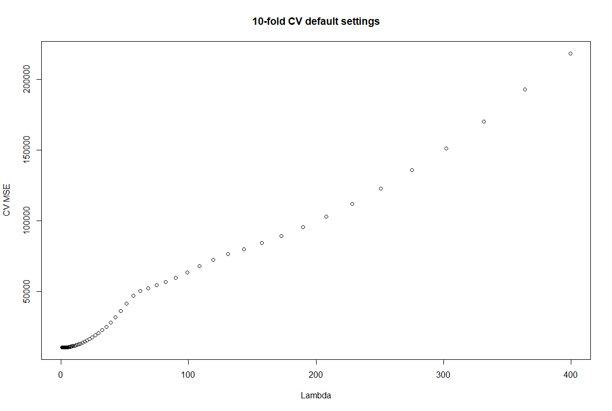{fig-align="center" width="75%"}

# Application: 10-fold CV (user grid)

Using refined user-defined grid:

- Selected $\lambda_{\min} = 2.03$.
- Identifies identical active set with calibrated penalty.

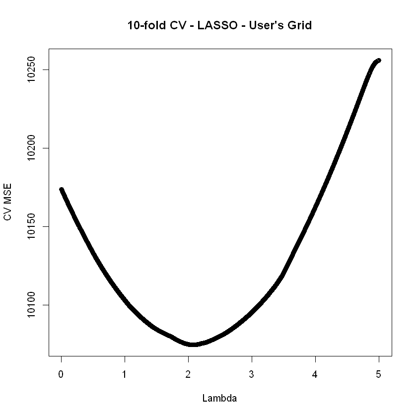{fig-align="center" width="75%"}

# Application: LOOCV

Leave-one-out cross-validation across the grid:

- Selected $\lambda_{\min} = 1.217$.
- Yields slightly smaller shrinkage penalty than 10-fold CV.

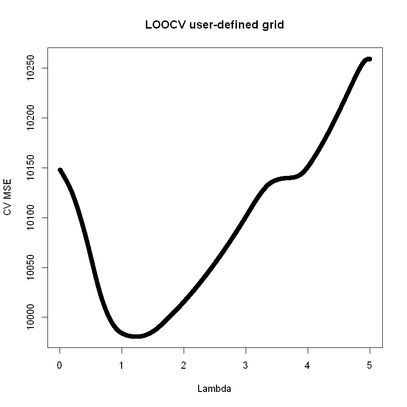{fig-align="center" width="75%"}

# Application: test set MSE

Comparison of out-of-sample prediction performance on Credit test set:

| Criterion | Selected $\lambda$ | Test MSE |
|:---|:---:|:---:|
| **LASSO 10-fold CV (user grid)** | **2.030** | **10,041.70** |
| **LASSO LOOCV** | 1.217 | 10,085.07 |
| **Elastic Net ($\alpha=0.5$)** | 2.009 | 10,098.10 |
| **Ridge 10-fold CV** | 1.500 | 10,122.75 |
| **Ridge LOOCV** | 0.658 | 10,145.75 |
| **OLS (unpenalized)** | 0 | 10,147.65 |
| **Post-LASSO 10-fold CV** | 8.806 | 10,155.77 |
| **Best Subset** | — | 10,155.78 |
| **Post-RLASSO (`hdm`)** | — | 10,281.33 |
| **RLASSO default (`hdm`)** | — | 10,466.18 |

# Application: final model coefficients

Comparing final selected coefficients: $\lambda = 2.03$ vs. unpenalized OLS ($\lambda = 0$):

| Predictor | LASSO ($\lambda = 2.03$) | OLS ($\lambda = 0$) |
|:---|:---:|:---:|
| **Income** | -7.726 | -7.992 |
| **Limit** | 0.190 | 0.185 |
| **Rating** | 1.128 | 1.264 |
| **Student** | 419.798 | 426.817 |
| **Cards** | 17.098 | 17.789 |
| **Age** | -0.477 | -0.567 |
| **Female** | -4.434 | -9.964 |
| **Asian** | 8.160 | 14.132 |
| **Education** | **0** | -0.188 |
| **Married** | **0** | 1.367 |
| **Caucasian** | **0** | 2.251 |

# Concluding remarks

- **LASSO fits even when $p > n$** (selects up to $n$ non-zero predictors).
- **Simultaneous variable selection and shrinkage**: produces sparse, highly interpretable models.
- **Post-LASSO estimation**: helps debias coefficients and mitigates attenuation bias.
- **Elastic Net**: overcomes collinearity and grouping issues by combining $\ell_1$ and $\ell_2$ penalties.
- **Tuning parameter choice**: critical in practice; use $K$-fold cross-validation (with 1SE rule) or theoretically justified plug-in rules (`rlasso`).

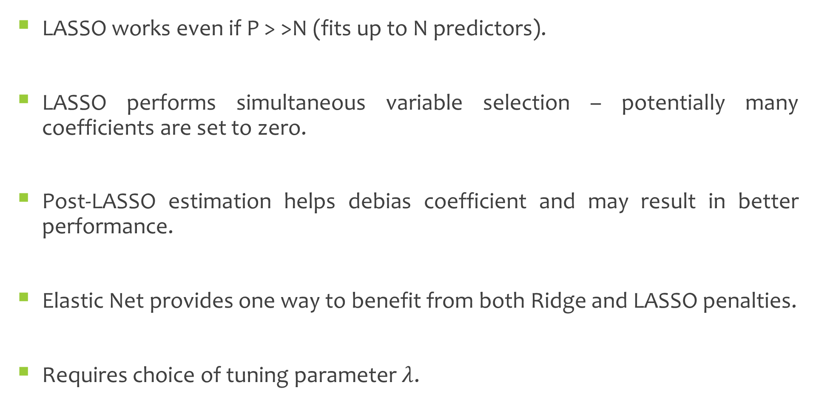{fig-align="center" width="75%"}
